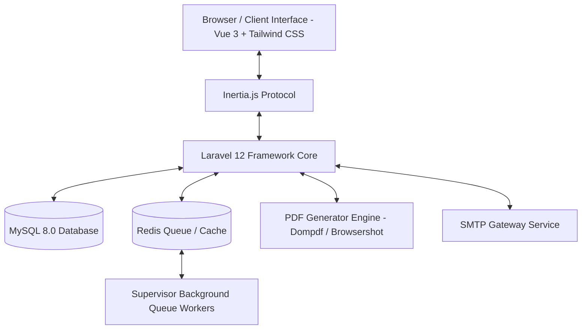
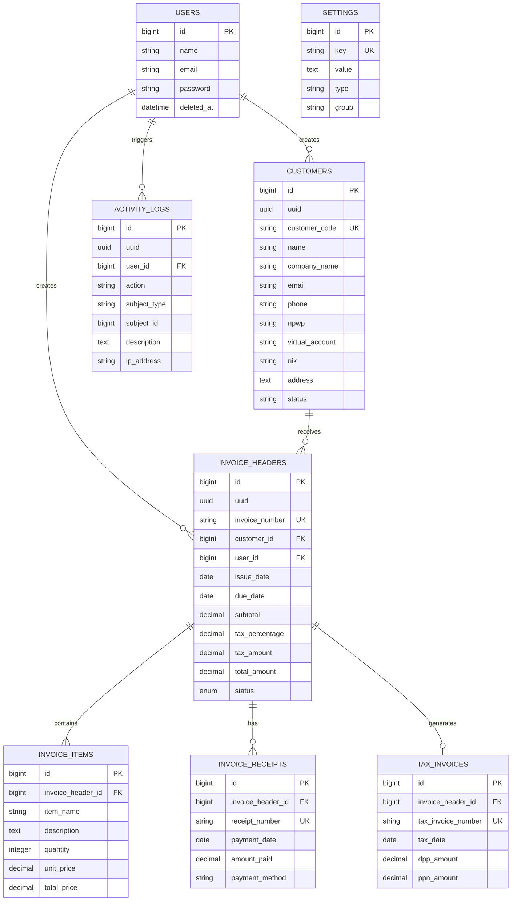
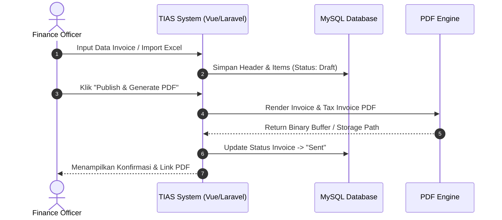
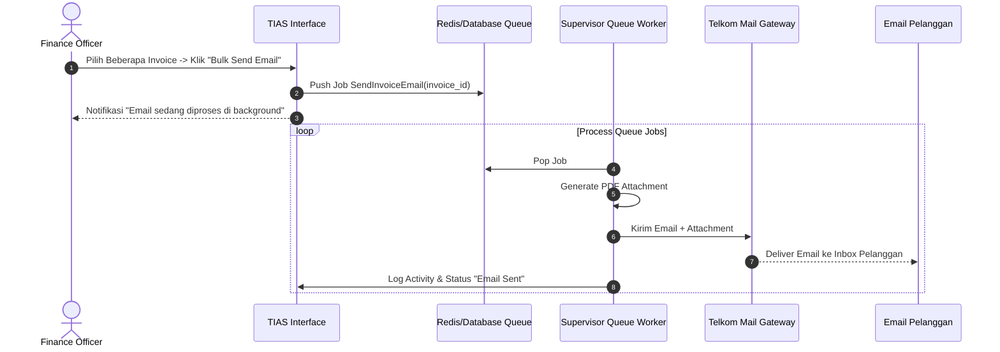

# Product Requirement Document (PRD)
## Telkom Invoice Automation System (TIAS)

**Versi Dokumen:** 1.0.0  
**Tanggal:** 26 Juli 2026  
**Status:** Approved for Final Report & Production Deployment  
**Instansi / Client:** PT. Telkom Indonesia (Persero) Tbk Witel Lampung  
**Pengembang:** Tim Pengembang Software / Software Engineering Team  

---

## 1. Eksekutif & Latar Belakang (Executive Summary & Background)

### 1.1 Latar Belakang Proyek
PT. Telkom Indonesia (Persero) Tbk Witel Lampung menangani ribuan transaksi invoicing dan penagihan untuk pelanggan korporat (B2B) dan perorangan secara berkala. Proses pembuatan, penerbitan, distribusi dokumen penagihan, dan pelaporan yang masih semi-manual memakan waktu operasional yang signifikan, rentan terhadap *human error*, serta memperlambat siklus *cash flow* perusahaan.

**Telkom Invoice Automation System (TIAS)** dibangun sebagai solusi modern berbasis web terintegrasi yang mengotomatisasi seluruh siklus hidup *invoicing*. TIAS memfasilitasi pengelolaan data pelanggan, otomatisasi penerbitan dokumen Tagihan (*Invoice*), Rincian Tagihan (*Billing Detail*), Kwitansi Pembayaran (*Official Receipt*), dan Faktur Pajak (*Tax Invoice*), hingga pengiriman masif berbasis antrean (*queue-based bulk email distribution*).

### 1.2 Tujuan Sistem
1. **Efisiensi Operasional:** Memangkas waktu pembuatan dan pengiriman dokumen penagihan dari hitungan hari menjadi hitungan menit.
2. **Akurasi Finansial:** Mengeliminasi kesalahan perhitungan subtotal, PPN (11%), diskon, dan total tagihan dengan sistem kalkulasi otomatis.
3. **Multidokumen Legitimasi:** Menghasilkan 4 tipe dokumen PDF berstandar profesional secara otomatis (Invoice, Rincian Tagihan, Kwitansi Pembayaran, dan Faktur Pajak).
4. **Skalabilitas Distribusi:** Mengirimkan ribuan email tagihan secara sinkron/asinkron menggunakan arsitektur *background worker* tanpa mengganggu kestabilan antarmuka pengguna.
5. **Transparansi & Akuntabilitas:** Mencatat seluruh transaksi dan aksi pengguna dalam *audit trail log* yang terpisah dan tidak dapat dimanipulasi.

---

## 2. Ruang Lingkup Proyek (Project Scope)

### 2.1 Ruang Lingkup Fungsional (In-Scope)
- **Modul Autentikasi & Keamanan:** Login, Reset Password, Pengelolaan Profil User, dan Manajemen Sesi.
- **Modul Manajemen Pelanggan (Customer Management):** Manajeman data pelanggan (CRUD), No. Virtual Account (VA), NPWP, NIK, Status Aktif/Inaktif, serta Impor & Ekspor Excel.
- **Modul Manajemen Invoice (Invoice Automation):** Pembuatan invoice tunggal/massal, item dinamis, status lifecycle (Draft, Sent, Paid, Overdue, Cancelled).
- **Modul PDF Engine:** Generator dokumen berbasis HTML to PDF (Dompdf / Browsershot) untuk 4 format dokumen resmi.
- **Modul Distribusi Email & Queue:** Pengiriman email tunggal dan pengiriman massal (*bulk*) dengan pengulangan otomatis (*retry logic*) serta pengujian SMTP.
- **Modul Dashboard Analytics:** Visualisasi KPI utama (Revenue, Paid/Unpaid ratio, Active Customers, Recent Activities).
- **Modul Pengaturan Sistem (Settings):** Konfigurasi identitas perusahaan, SMTP Server, dan parameter PPN/Termin Pembayaran.
- **Modul Audit Trail (Activity Logs):** Pencatatan riwayat aktivitas pengguna (*IP address*, *User Agent*, jenis aksi, dan timestamp).

### 2.2 Luar Ruang Lingkup (Out-of-Scope)
- Integrasi Payment Gateway langsung (seperti Midtrans/Xendit) untuk auto-settlement (menggunakan mekanisme pencatatan manual / rekonsiliasi bank pada versi 1.0).
- Aplikasi Mobile Android/iOS Native (sistem difokuskan pada Web Responsive Application).

---

## 3. Profil Pengguna & Hak Akses (User Personas & Roles)

| Role | Deskripsi | Hak Akses Utama |
|---|---|---|
| **System Administrator** | Pengelola utama konfigurasi infrastruktur dan akun pengguna. | Mengelola user, konfigurasi SMTP server, variabel sistem, melihat audit trail lengkap, dan pemeliharaan basis data. |
| **Finance / Billing Officer** | Staf keuangan/penagihan yang bertanggung jawab atas penagihan harian. | Mengelola data pelanggan, membuat & mengedit invoice, melakukan pengimporan data massal, mengunduh PDF, dan mengirim email penagihan. |

---

## 4. Arsitektur & Spesifikasi Teknologi (Technical Architecture & Stack)

### 4.1 Technology Stack

- **Backend Framework:** Laravel 12 (PHP 8.3 / 8.4)
- **Frontend Framework:** Vue.js 3 (Composition API) + Inertia.js 2.0
- **Styling & UI:** Tailwind CSS v3/v4 + Lucide Vue Icons
- **Database Engine:** MySQL 8.0 / MariaDB 10.6+
- **Queue & Process Control:** Redis 7.0 / Supervisor Process Manager
- **PDF Rendering Engine:** `barryvdh/laravel-dompdf` / `spatie/browsershot`
- **Spreadsheet Processor:** `maatwebsite/excel` (PhpSpreadsheet)
- **Web Server:** Nginx 1.24+ (Reverse Proxy & SSL Termination)

### 4.2 Spesifikasi Minimum Server (Production Environment)
- **OS:** Ubuntu 22.04 LTS / Debian 12
- **Processor:** 4 Core CPU
- **RAM:** 8 GB Memory
- **Storage:** 80 GB SSD (NVMe Recommended)
- **Network:** High-speed internet with static IP & SSL Certificate

---

## 5. Spesifikasi Kebutuhan Fungsional (Functional Requirements)

### 5.1 Modul Autentikasi & Keamanan (FR-AUTH)
- **FR-AUTH-01:** Sistem harus memvalidasi kredensial pengguna (email & password) saat login.
- **FR-AUTH-02:** Sistem harus menyediakan fitur *Soft Deletes* pada akun pengguna untuk keamanan data.
- **FR-AUTH-03:** Pengguna dapat memperbarui profil pribadi (nama, email, dan ubah password).

### 5.2 Modul Manajemen Pelanggan (FR-CUST)
- **FR-CUST-01:** Sistem harus dapat mencatat data pelanggan: Kode Pelanggan, Nama, Nama Perusahaan, Email, No. HP, NPWP, Virtual Account (VA), NIK, Alamat Tagihan, dan Kota.
- **FR-CUST-02:** Sistem harus mendukung pencarian, pengurutan, dan penyaringan (*filtering*) data pelanggan.
- **FR-CUST-03:** Sistem harus menyediakan fitur **Impor Massal Pelanggan** menggunakan file Excel (.xlsx/.csv).
- **FR-CUST-04:** Sistem harus menyediakan fitur **Ekspor Data Pelanggan** ke format Excel.

### 5.3 Modul Manajemen Invoice (FR-INV)
- **FR-INV-01:** Sistem dapat membuat invoice baru dengan penomoran unik otomatis (*auto-generated invoice number*).
- **FR-INV-02:** Setiap invoice mendukung multiple *item lines* (Deskripsi, Kuantitas, Harga Satuan, Total Line).
- **FR-INV-03:** Sistem menghitung secara otomatis: Subtotal, Persentase PPN (misal 11%), Nilai PPN, Diskon, dan Total Akhir Tagihan.
- **FR-INV-04:** Sistem mendukung siklus status invoice: `Draft`, `Sent`, `Paid`, `Overdue`, dan `Cancelled`.
- **FR-INV-05:** Sistem mendukung fitur **Impor Massal Invoice** dari spreadsheet Excel beserta template yang dapat diunduh.

### 5.4 Modul PDF Document Engine (FR-PDF)
- **FR-PDF-01 (Invoice Standard):** Meng-generate PDF Invoice resmi A4 dengan header logo Telkom Indonesia, rincian item, dan ringkasan pembayaran.
- **FR-PDF-02 (Billing Detail):** Meng-generate PDF Rincian Tagihan teknis untuk lampiran analisis keuangan pelanggan.
- **FR-PDF-03 (Receipt/Kwitansi):** Meng-generate PDF Kwitansi Pembayaran Resmi jika status invoice `Paid`.
- **FR-PDF-04 (Tax Invoice/Faktur Pajak):** Meng-generate PDF Faktur Pajak sesuai regulasi perpajakan yang berlaku.
- **FR-PDF-05:** Pengguna dapat melakukan preview (*stream inline*) atau langsung mengunduh (*force download*) file PDF.

### 5.5 Modul Distribusi Email & Queue Worker (FR-MAIL)
- **FR-MAIL-01:** Sistem dapat mengirimkan email invoice individual beserta lampiran PDF otomatis kepada pelanggan.
- **FR-MAIL-02:** Sistem dapat melakukan **Bulk Email Dispatch** ke ratusan pelanggan sekaligus melalui antrean *background worker* (Supervisor + Redis/Database Queue).
- **FR-MAIL-03:** Sistem menyediakan tombol **Retry Email** untuk mengirim ulang email yang gagal terkirim (*failed job*).

### 5.6 Modul Pengaturan & Audit (FR-SYS)
- **FR-SYS-01:** Pengguna dapat mengonfigurasi parameter SMTP Mailer (Host, Port, Username, Password, Encryption) dan mengujinya melalui fitur *Live SMTP Test*.
- **FR-SYS-02:** Sistem dapat mencatat seluruh log aktivitas pengguna (Aksi: Create, Update, Delete, Export, Send Mail) beserta IP Address dan Browser Signature di tabel `activity_logs`.

---

## 6. Spesifikasi Kebutuhan Non-Fungsional (Non-Functional Requirements)

### 6.1 Performa & Skalabilitas (Performance)
- Response time aplikasi untuk navigasi halaman < 1.5 detik (menggunakan Inertia SPA Navigation).
- PDF Generation time < 2.5 detik per dokumen.
- Pengiriman email masif dikelola secara asinkron sehingga tidak mengunci (*block*) koneksi browser pengguna.

### 6.2 Keamanan Data (Security)
- Seluruh password dienkripsi menggunakan algoritma `Bcrypt`.
- Komunikasi data wajib menggunakan protokol enkripsi HTTPS (TLS 1.2 / 1.3).
- Proteksi terhadap serangan CSRF (Cross-Site Request Forgery) dan XSS (Cross-Site Scripting) bawaan framework Laravel.
- Penggunaan UUID v4 untuk identifikasi publik resource agar terhindar dari *enumeration attack*.

### 6.3 Keandalan & Ketersediaan (Reliability & Availability)
- Sistem dirancang untuk ketersediaan tinggi (*Availability target 99.5%*).
- Penggunaan Supervisor daemon untuk memastikan *Queue Worker* terus berjalan secara otomatis jika terjadi perbaikan/reboot server.

---

## 7. Skema Basis Data (Database Entity-Relationship Schema)

---

## 8. Alur Kerja Utama Sistem (Core System Workflows)

### 8.1 Workflow Pembuatan & Penerbitan Invoice

### 8.2 Workflow Pengiriman Massal Email (Bulk Email Queue)

---

## 9. Rencana Pengujian & Penerimaan (Verification & Acceptance Criteria)

### 9.1 Skenario Pengujian Fungsional (User Acceptance Testing / UAT)

| No | Modul | Skenario Pengujian | Hasil yang Diharapkan | Status |
|---|---|---|---|---|
| 1 | Auth | Login dengan kredensial valid | Berhasil masuk ke Dashboard | Passed |
| 2 | Customer | Impor file Excel berisi 100 data pelanggan | Data tersimpan tanpa duplikasi Kode Pelanggan | Passed |
| 3 | Invoice | Membuat invoice dengan 3 item barang + PPN 11% | Kalkulasi subtotal, PPN, dan Total akurat | Passed |
| 4 | PDF | Mengunduh PDF Invoice, Kwitansi, & Faktur Pajak | Layout rapi, logo Telkom tampil, format A4 presisi | Passed |
| 5 | Bulk Mail | Mengirimkan 50 email invoice secara bersamaan | Queue menangani pengiriman di background tanpa error | Passed |
| 6 | Audit Log | Mengedit data invoice | Aksi terekam di halaman Activity Logs beserta IP user | Passed |

---

## 10. Kesimpulan & Rekomendasi (Conclusion & Future Work)

### 10.1 Kesimpulan
**Telkom Invoice Automation System (TIAS)** telah berhasil dirancang dan diimplementasikan sesuai dengan kebutuhan operasional PT. Telkom Indonesia Witel Lampung. Sistem ini membuktikan peningkatan efisiensi yang signifikan dalam pembuatan dokumen penagihan, eliminasi kesalahan kalkulasi finansial, serta mempercepat distribusi email penagihan secara massal.

### 10.2 Rekomendasi Pengembangan Selanjutnya
1. **Integrasi Open API Payment Gateway:** Menambahkan fitur pembayaran otomatis via QRIS / Bank Transfer dengan *Webhooks notification*.
2. **Auto Reminder WhatsApp Integration:** Menambahkan saluran pengiriman pengingat tagihan jatuh tempo via WhatsApp Gateway API.
3. **Multi-Tenant / Branch Support:** Pengembangan sistem agar dapat digunakan lintas Witel / Regional di seluruh Indonesia.

---
*Dokumen PRD ini disusun sebagai acuan teknis utama dalam Laporan Akhir Proyek Sistem Automasi Invoicing Telkom (TIAS).*
